# Technical Guide: MySQL Replication for Disaster Recovery (DR) Architecture

A comprehensive technical guide demonstrating how to implement **MySQL Replication** to maintain near real-time data synchronization between a **Production Environment (Primary Data Center)** and a **Disaster Recovery (DR) Center**, complete with step-by-step evidence, troubleshooting, and failover procedures.

---

## Table of Contents
- [1. Overview & Disaster Recovery Architecture](#1-overview--disaster-recovery-architecture)
  - [1.1 What is MySQL Replication?](#11-what-is-mysql-replication)
  - [1.2 Disaster Recovery (DR) Architectural Design](#12-disaster-recovery-dr-architectural-design)
  - [1.3 Core Components & Traffic Flow](#13-core-components--traffic-flow)
- [2. Prerequisites & Environment Setup](#2-prerequisites--environment-setup)
  - [2.1 Docker Compose Configuration](#21-docker-compose-configuration)
  - [2.2 Verifying Container Status](#22-verifying-container-status)
  - [2.3 Initial State in Database Client](#23-initial-state-in-database-client)
- [3. Step-by-Step MySQL Replication Implementation](#3-step-by-step-mysql-replication-implementation)
  - [3.1 Step 1: Master Configuration (server-id & binlog)](#31-step-1-master-configuration-server-id--binlog)
  - [3.2 Step 2: Slave Configuration (server-id & relay-log)](#32-step-2-slave-configuration-server-id--relay-log)
  - [3.3 Step 3: Create Dedicated Replication User on Master](#33-step-3-create-dedicated-replication-user-on-master)
  - [3.4 Step 4: Check Binary Log Coordinates on Master](#34-step-4-check-binary-log-coordinates-on-master)
  - [3.5 Step 5: Configure Replication Parameters on Slave](#35-step-5-configure-replication-parameters-on-slave)
  - [3.6 Step 6: Verify Unique Server IDs](#36-step-6-verify-unique-server-ids)
  - [3.7 Step 7: Start Replica & Confirm Health Status](#37-step-7-start-replica--confirm-health-status)
  - [3.8 Step 8: Verify Real-Time Data Synchronization](#38-step-8-verify-real-time-data-synchronization)
- [4. Troubleshooting & Failover Procedures](#4-troubleshooting--failover-procedures)
  - [4.1 Issue 1: Equal Server IDs Error (IO Thread Stopped)](#41-issue-1-equal-server-ids-error-io-thread-stopped)
  - [4.2 Issue 2: Replication Desynchronization (SQL Thread Error 1008)](#42-issue-2-replication-desynchronization-sql-thread-error-1008)
  - [4.3 DR Drill: Promoting Slave Node to New Primary](#43-dr-drill-promoting-slave-node-to-new-primary)
- [5. Best Practices & Summary](#5-best-practices--summary)
  - [5.1 Production Best Practices](#51-production-best-practices)
  - [5.2 Summary](#52-summary)

---

## 1. Overview & Disaster Recovery Architecture

### 1.1 What is MySQL Replication?
**MySQL Replication** is a native mechanism that allows data from one MySQL database server (the **Source / Primary / Master**) to be copied automatically and asynchronously to one or more database servers (the **Replica / Secondary / Slave**).

#### How it works internally:
1. **Binary Log (Binlog)**: The Master records all data modifications (DDL and DML events) into binary log files.
2. **I/O Thread**: The Slave connects to the Master, reads new events from the Master's binary log, and writes them locally into a **Relay Log**.
3. **SQL Thread**: The Slave reads the events recorded in its local Relay Log and applies them sequentially to the Slave's storage engine.

```
+----------------+      Binlog Dump      +---------------------------------+
|  MySQL Master  |  ------------------>  |           MySQL Slave           |
|                |                       |  +------------+  +------------+ |
| [Binary Log]   |                       |  | I/O Thread |  | SQL Thread | |
+----------------+                       |  +-----+------+  +-----+------+ |
                                         |        |               ^        |
                                         |        v               |        |
                                         |      [ Relay Log Files ]        |
                                         +---------------------------------+
```

---

### 1.2 Disaster Recovery (DR) Architectural Design

A primary concern for modern applications is **Business Continuity**. If the primary Data Center (DC) suffers a power outage, network disruption, or hardware failure, an enterprise must have a **Disaster Recovery Center (DRC)** ready to take over without significant data loss (low **RPO** - Recovery Point Objective) and minimal downtime (low **RTO** - Recovery Time Objective).

Below is the architectural diagram of our Disaster Recovery design:

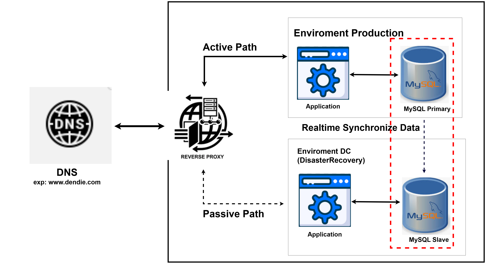

---

### 1.3 Core Components & Traffic Flow

1. **DNS & Reverse Proxy / Load Balancer**:
   - External clients access the application via a common domain (e.g., `www.dendie.com`).
   - The Reverse Proxy routes incoming HTTP/HTTPS traffic to the active environment.
2. **Production Environment (Active Path)**:
   - Contains the live Application and **MySQL Primary (Master)** running on port `3306`.
   - All write operations (`INSERT`, `UPDATE`, `DELETE`) and read operations are directed here during normal operations.
3. **Real-time Data Synchronization**:
   - The Master streams binary log events continuously across the network to the Slave.
   - The data in the DR environment remains up-to-date with minimal lag.
4. **Disaster Recovery Environment (Passive Path)**:
   - Contains the standby Application and **MySQL Slave (Replica)** running on port `3307`.
   - The MySQL instance is set to `read-only = 1` to prevent split-brain scenarios and accidental rogue writes.
   - The path remains **passive** (idle) until a disaster occurs, at which point the Reverse Proxy / DNS reroutes traffic here.

---

## 2. Prerequisites & Environment Setup

### 2.1 Docker Compose Configuration
To simulate both environments locally, we use Docker Compose with two containers: `mysql-master` (Primary DC) and `mysql-slave` (DRC).

```yaml
version: '3.8'

services:
  mysql-master:
    image: mysql:8.0
    container_name: mysql-master
    environment:
      MYSQL_ROOT_PASSWORD: rootpasswordku
      MYSQL_DATABASE: namadatabase
    ports:
      - "3306:3306"
    volumes:
      - ./master.cnf:/etc/mysql/conf.d/master.cnf
      - master_data:/var/lib/mysql
    networks:
      - mysql-net

  mysql-slave:
    image: mysql:8.0
    container_name: mysql-slave
    environment:
      MYSQL_ROOT_PASSWORD: rootpasswordku
    ports:
      - "3307:3306"
    volumes:
      - ./slave.cnf:/etc/mysql/conf.d/slave.cnf
      - slave_data:/var/lib/mysql
    depends_on:
      - mysql-master
    networks:
      - mysql-net

volumes:
  master_data:
  slave_data:

networks:
  mysql-net:
    driver: bridge
```

Start the containers by executing:
```bash
docker-compose up -d
```

---

### 2.2 Verifying Container Status
After spinning up the environment, verify that both containers are running properly:

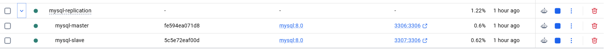

- `mysql-master` is mapped to host port `3306`.
- `mysql-slave` is mapped to host port `3307`.

---

### 2.3 Initial State in Database Client
Connect both nodes to a database management tool (such as DBeaver):

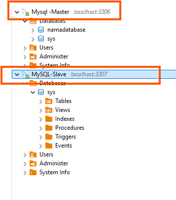

- **Master Node (`localhost:3306`)**: Contains database `namadatabase` and default system tables.
- **Slave Node (`localhost:3307`)**: Contains only default system tables (`sys`). Notice that the database `namadatabase` has not yet been replicated.

---

## 3. Step-by-Step MySQL Replication Implementation

Follow this numbered step-by-step technical guide to configure and establish real-time replication.

---

### 3.1 Step 1: Master Configuration (`server-id` & `binlog`)
To participate in replication, the Master node must have a unique `server-id` and binary logging enabled.

Edit `master.cnf`:
```ini
[mysqld]
server-id=1
log-bin=mysql-bin
```

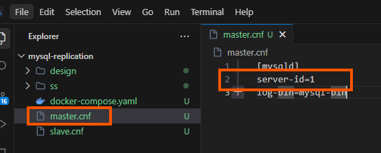

- `server-id=1`: Identifies this server uniquely in the replication topology.
- `log-bin=mysql-bin`: Enables binary logging, which writes data alteration events to disk.

---

### 3.2 Step 2: Slave Configuration (`server-id` & `relay-log`)
The Slave node must also have a unique `server-id` (different from Master), a relay log file specified, and read-only mode activated.

Edit `slave.cnf`:
```ini
[mysqld]
server-id=2
relay-log=mysql-relay-bin
read-only=1
```

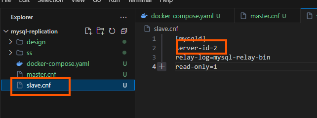

- `server-id=2`: Must differ from Master (`server-id=1`).
- `relay-log=mysql-relay-bin`: Designates the local relay log storage for incoming binary events.
- `read-only=1`: Prevents non-administrative users from modifying data directly on the replica.

---

### 3.3 Step 3: Create Dedicated Replication User on Master
Connect to the `mysql-master` container and create a user dedicated to replication with the `REPLICATION SLAVE` privilege.

```bash
docker exec -it mysql-master mysql -uroot -prootpasswordku
```

Execute the following SQL commands:
```sql
CREATE USER 'repl'@'%' IDENTIFIED WITH mysql_native_password BY 'passwordrepl';
GRANT REPLICATION SLAVE ON *.* TO 'repl'@'%';
FLUSH PRIVILEGES;
```

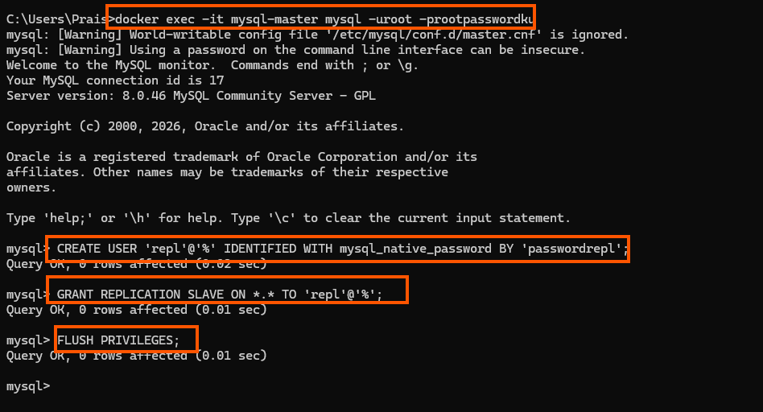

---

### 3.4 Step 4: Check Binary Log Coordinates on Master
Check the current binary log filename and log position on the Master:

```sql
SHOW MASTER STATUS;
```

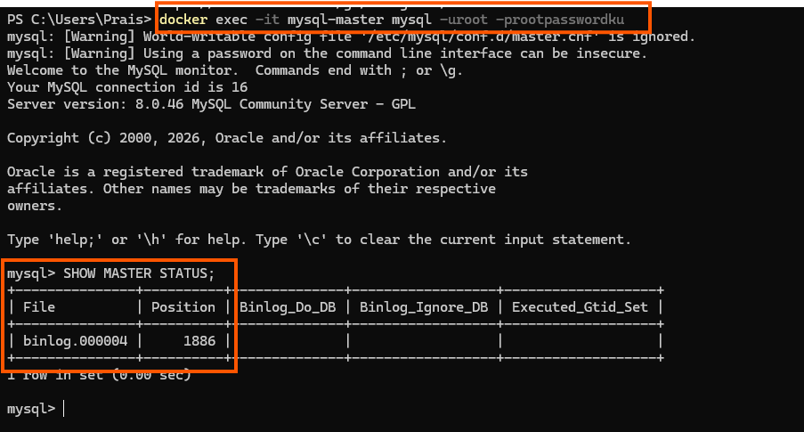

Take note of the output values:
- **File**: `binlog.000004`
- **Position**: `1886`

> **Note**: These coordinates represent the exact checkpoint from which the Slave will begin streaming events.

---

### 3.5 Step 5: Configure Replication Parameters on Slave
Connect to the `mysql-slave` container:

```bash
docker exec -it mysql-slave mysql -uroot -prootpasswordku
```

Stop any running replica process and set up the connection pointing to `mysql-master`:

```sql
STOP REPLICA;

CHANGE MASTER TO
  MASTER_HOST='mysql-master',
  MASTER_USER='repl',
  MASTER_PASSWORD='passwordrepl',
  MASTER_LOG_FILE='binlog.000004',
  MASTER_LOG_POS=1886;
```

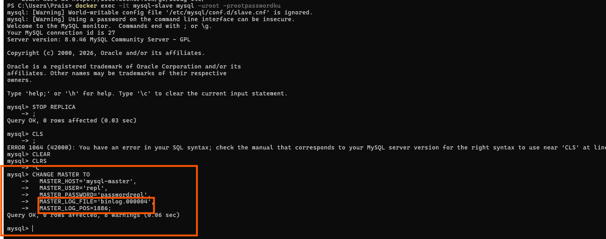

---

### 3.6 Step 6: Verify Unique Server IDs
Before starting the replica, verify that both servers have distinct `server_id` values:

#### Master Node (`localhost:3306`):
```sql
SELECT @@server_id;
-- Output: 1
```
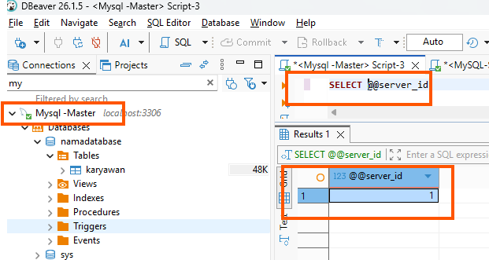

#### Slave Node (`localhost:3307`):
```sql
SELECT @@server_id;
-- Output: 2
```
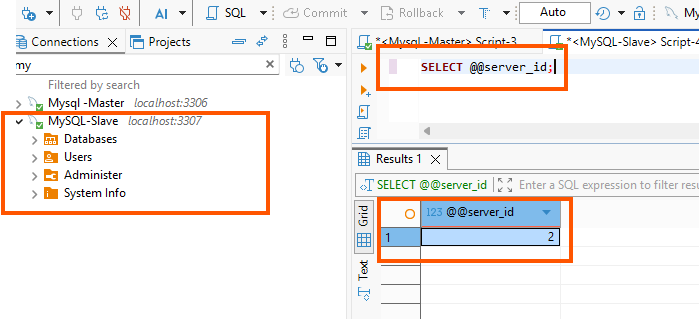

---

### 3.7 Step 7: Start Replica & Confirm Health Status
Start the replica background threads on the Slave node:

```sql
START REPLICA;
SHOW REPLICA STATUS\G
```

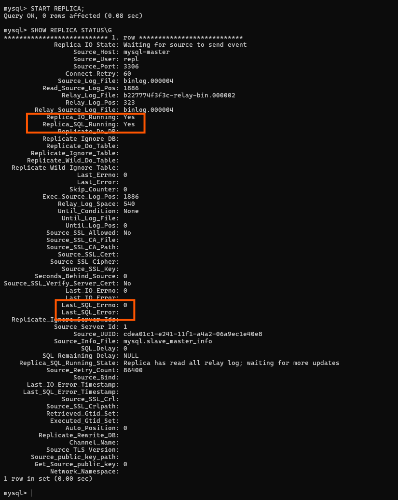

#### Crucial Health Indicators:
- `Replica_IO_Running: Yes` (The I/O thread is connected and receiving binlog events).
- `Replica_SQL_Running: Yes` (The SQL thread is reading relay logs and applying changes).
- `Last_SQL_Errno: 0` & `Last_SQL_Error: [Empty]` (No errors occurred).
- `Seconds_Behind_Source: 0` (The replica is fully caught up in real-time).

---

### 3.8 Step 8: Verify Real-Time Data Synchronization
To verify synchronization, create a table or insert records into the Master database (`crm.customer`). Check the Slave database to confirm that the new records appear instantly:

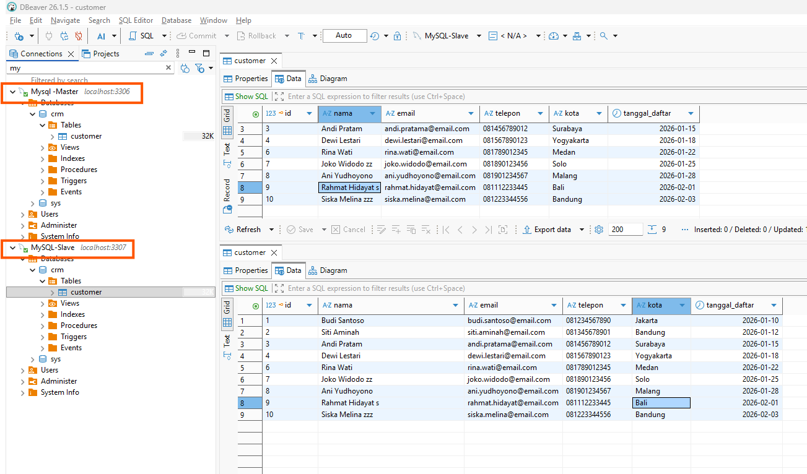

As shown in DBeaver:
- Records inserted on `Mysql -Master localhost:3306` (e.g., ID 3 to 10) are immediately visible on `MySQL-Slave localhost:3307`.
- Data is synchronized in near real-time without manual intervention.

---

## 4. Troubleshooting & Failover Procedures

During setup and disaster drills, common issues can arise. Here are the documented troubleshooting steps and solutions.

---

### 4.1 Issue 1: Equal Server IDs Error (IO Thread Stopped)

#### Symptom:
Running `SHOW REPLICA STATUS\G` shows `Replica_IO_Running: No` with the following error:
```text
Last_IO_Error: Fatal error: The replica I/O thread stops because source and replica have equal MySQL server ids; these ids must be different for replication to work...
```

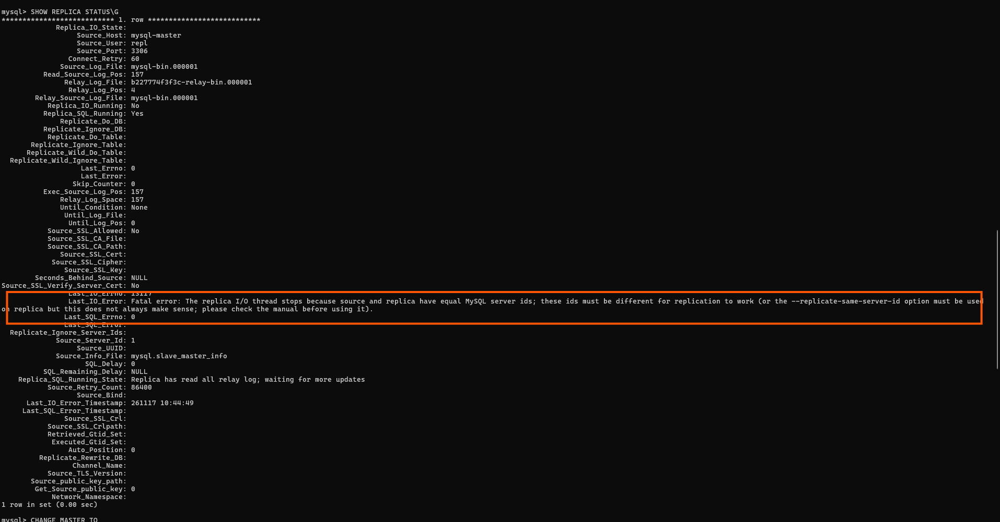

#### Root Cause:
1. Both instances share the default `server_id = 1`.
2. When mounting configuration files on Windows hosts, Docker assigns `0777` permissions to `.cnf` files. MySQL ignores world-writable configuration files (`World-writable config file ... is ignored`) for security, falling back to default IDs.

#### Solution:
Dynamically update and persist a unique `server_id` directly in MySQL on the Slave node:

```sql
STOP REPLICA;
SET PERSIST server_id = 2;
START REPLICA;
```

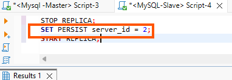

> **Tip**: `SET PERSIST` writes the variable to `/var/lib/mysql/mysqld-auto.cnf`, ensuring the configuration survives container restarts.

---

### 4.2 Issue 2: Replication Desynchronization (SQL Thread Error 1008)

#### Symptom:
`SHOW REPLICA STATUS\G` reports:
- `Replica_IO_Running: Yes`
- `Replica_SQL_Running: No`
- `Last_SQL_Errno: 1008`
- `Last_SQL_Error: Coordinator stopped because there were error(s) in the worker(s)...`

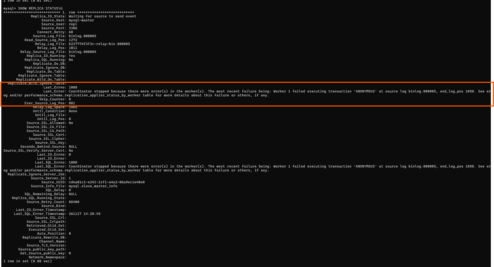

#### Root Cause:
This error occurs when the Slave tries to execute an event from the relay log that fails (e.g., dropping a non-existent database or modifying a row that was altered directly on the slave).

#### Solution:
Skip the conflicting transaction using `sql_replica_skip_counter`:

```sql
STOP REPLICA;
SET GLOBAL sql_replica_skip_counter = 1;
START REPLICA;
```

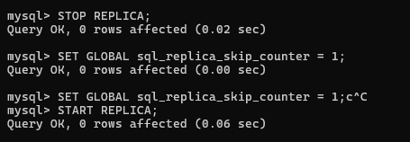

Verify with `SHOW REPLICA STATUS\G` that `Replica_SQL_Running` returns to `Yes`.

---

### 4.3 DR Drill: Promoting Slave Node to New Primary

In the event of a total failure at the primary Data Center, execute failover by promoting the Slave to become the new standalone Primary (Master).

Connect to the Slave node (`localhost:3307`) and execute:

```sql
-- 1. Stop the replication process
STOP REPLICA;

-- 2. Clear all replication connection metadata and reset coordinates
RESET REPLICA ALL;

-- 3. Turn off read-only mode so application can perform write operations
SET GLOBAL read_only = OFF;

-- 4. Verify that this node can now act as a binary log master
SHOW MASTER STATUS;
```

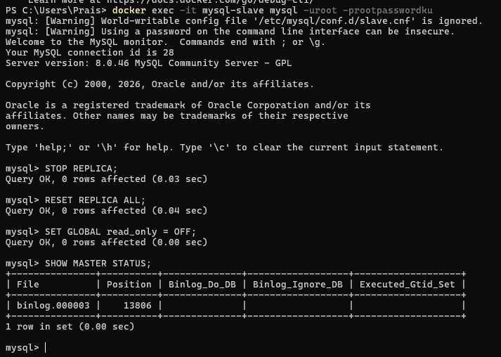

#### Post-Promotion Actions:
1. Update DNS or Reverse Proxy routing so client traffic points to the Disaster Recovery node.
2. The DR node is now actively processing both reads and writes.

---

## 5. Best Practices & Summary

### 5.1 Production Best Practices
1. **Always Set `read_only = 1` on Replicas**: Prevents accidental direct modifications on the replica node which leads to replication errors.
2. **Use GTID (Global Transaction Identifier)**: For modern MySQL 8.0 setups, GTID simplifies failover without needing manual `MASTER_LOG_FILE` and `MASTER_LOG_POS` tracking.
3. **Dedicated Replication Accounts**: Never use the `root` account for replication; create a dedicated user with minimal permissions (`GRANT REPLICATION SLAVE`).
4. **Monitor `Seconds_Behind_Source`**: Set up automated alerting when replication lag exceeds your service SLA threshold.
5. **Periodic DR Drills**: Regularly test failover and promotion procedures to ensure minimal RTO during real emergencies.

---

### 5.2 Summary
By implementing **MySQL Replication**, organizations can create a resilient **Disaster Recovery (DR)** architecture that balances operational simplicity with real-time data protection. In normal conditions, data flows seamlessly from the Primary DC to the DR Center; in an outage, the DR node can be cleanly promoted to primary in seconds.

